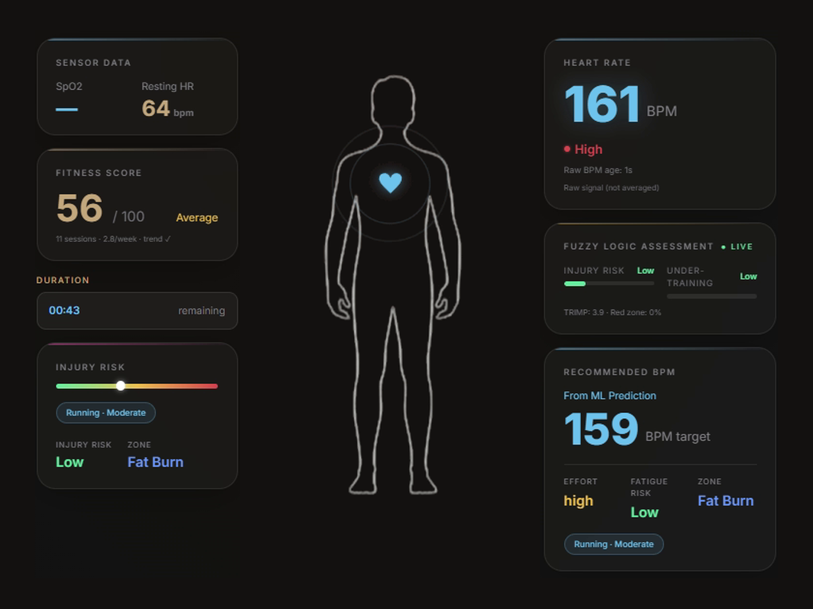
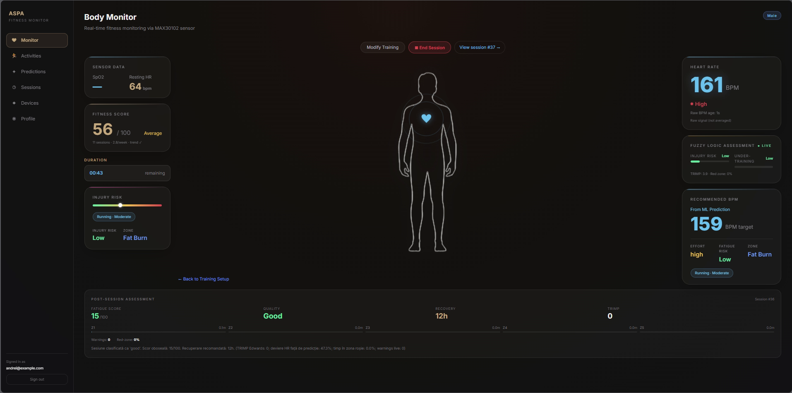
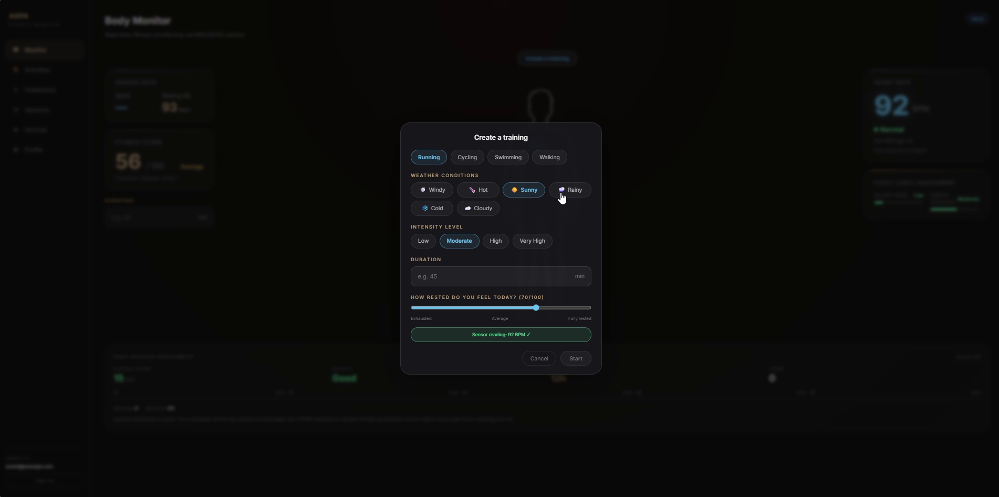
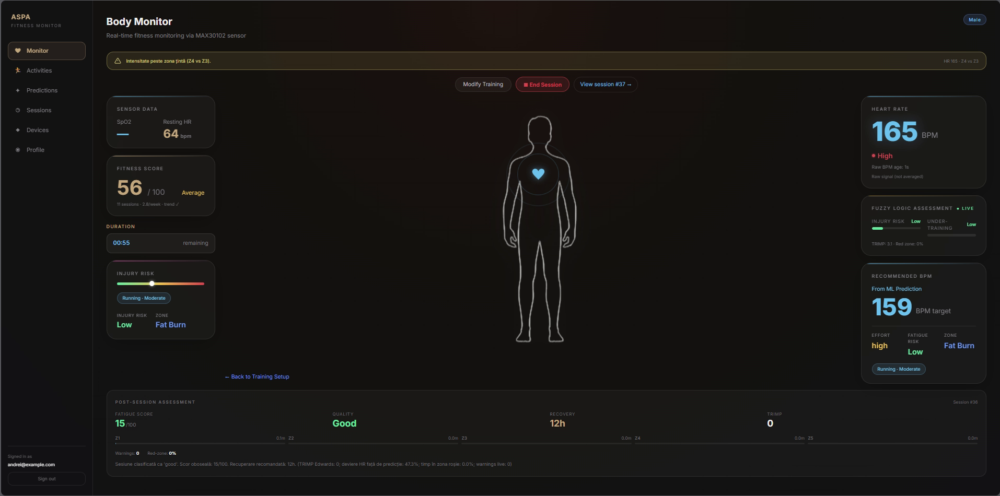
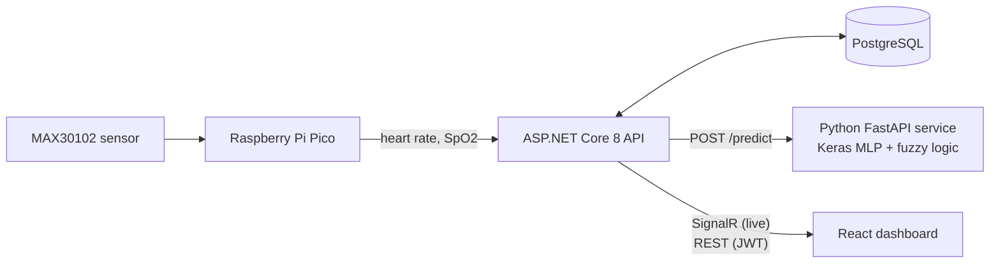

# ASPA – Fitness Monitor

**Sports performance analysis and injury prevention platform** · Bachelor's thesis project

ASPA monitors a workout in real time. A MAX30102 pulse-oximetry sensor on a Raspberry Pi Pico streams heart rate and SpO2 to an ASP.NET Core backend, which pushes every reading live to a React dashboard. Before the workout, a neural network predicts the heart rate the athlete should train at. During it, a fuzzy-logic engine rates injury and under-training risk and warns when the heart rate leaves the target zone. Afterwards, the session gets a fatigue score, a recovery time and a training load (TRIMP).

<p align="center">
  
</p>

---

## Features

**Live monitoring**
- Heart rate and SpO2 from the MAX30102 sensor, shown as they arrive (raw signal, not averaged)
- Sensor status: online, waiting for the sensor, or stale signal when the Pico stops sending valid beats
- Resting heart rate and a fitness score (0–100) based on session history and training frequency

**Training setup**
- Activity: running, cycling, swimming or walking
- Weather: windy, hot, sunny, rainy, cold or cloudy
- Intensity (low → very high), planned duration and "how rested do you feel today" (0–100)
- A live sensor check before the session starts

**AI and fuzzy logic**
- **Recommended BPM**: a Keras MLP predicts the target heart rate for this athlete, activity and conditions
- **Anomaly detection**: the measured heart rate is compared with the prediction (a gap over 20 bpm is flagged)
- **Fuzzy-logic assessment**: effort level, fatigue risk, injury risk and under-training, updated live
- **Live alerts** when the heart rate goes above the target zone

**Post-session assessment**
- Fatigue score, session quality and recommended recovery time
- TRIMP (Edwards) training load and time spent in each heart-rate zone (Z1–Z5)
- Number of live warnings, time in the red zone and how far the heart rate drifted from the prediction

**Platform**
- Accounts with JWT access tokens and refresh tokens, plus an Admin role
- Activity history, saved predictions and the user's health profile
- Swagger UI for the REST API

---

## Screenshots

| Live session | Training setup |
|---|---|
|  |  |

**Above the target zone:** the dashboard warns the athlete as soon as the heart rate leaves the zone the model recommended.



---

## Architecture



| Part | Technology |
|---|---|
| Frontend | React 19, TypeScript, Vite |
| Backend | ASP.NET Core 8 Web API, SignalR, Entity Framework Core, JWT authentication, Swagger |
| Database | PostgreSQL 16 (Npgsql) |
| AI service | Python, FastAPI, TensorFlow/Keras, scikit-learn, pandas |
| Hardware | Raspberry Pi Pico, MAX30102 heart-rate and SpO2 sensor |
| DevOps | Docker, Docker Compose |

The backend follows a layered structure: **Controllers → Services → Repositories → EF Core**. It calls the AI service through a typed `HttpClient`, and every AI request is logged in the database.

---

## AI model

The model predicts the **average heart rate** of an activity from the athlete's profile and the training context.

| | |
|---|---|
| Inputs | weight, age, BMI, gender, activity type, duration, intensity, weather |
| Preprocessing | missing values removed, one-hot encoding for categorical features, `StandardScaler` |
| Network | Dense 64 (ReLU) → Dense 32 (ReLU) → Dense 1 (linear) |
| Training | Adam optimizer, MSE loss, MAE metric, early stopping |
| Data split | 70% training · 20% validation · 10% test |
| Baseline | Ridge regression, used to measure how much the neural network adds |

The fuzzy-logic layer (`fuzzy_logic.py`) sits on top of the model. It is deliberately kept separate from the ML pipeline. It uses triangular and trapezoidal membership functions over the predicted heart rate and the measured-vs-predicted difference, and returns:

- `effort_level`: low, moderate, high or extreme
- `fatigue_risk`: low, medium or high
- `recommendation`: a short training recommendation

---

## API

All endpoints except register, login and refresh need a `Bearer` token.

| Method | Endpoint | Description |
|---|---|---|
| POST | `/api/auth/register` | Create an account |
| POST | `/api/auth/login` | Log in, returns access and refresh tokens |
| POST | `/api/auth/refresh` | Get a new access token |
| POST | `/api/auth/change-password` | Change the password |
| GET / PUT | `/api/profile` | Read or update the health profile |
| GET / POST | `/api/activities` | List or create activities |
| GET / PUT / DELETE | `/api/activities/{id}` | Read, update or delete an activity |
| POST | `/api/predictions/run/{activityId}` | Run the AI prediction for an activity |
| GET | `/api/predictions` | List predictions |
| GET | `/api/predictions/{id}` | Read a prediction |
| GET | `/api/predictions/activity/{activityId}` | Predictions for one activity |
| GET | `/api/admin/users` · `/activities` · `/predictions` | Admin overview (Admin role only) |

The AI service has a single endpoint, `POST http://localhost:8000/predict`.

---

## Getting started

### Prerequisites

- [.NET 8 SDK](https://dotnet.microsoft.com/download/dotnet/8.0)
- [Node.js](https://nodejs.org/) 20 or newer
- Python 3.12
- PostgreSQL 16, or Docker to run it in a container

### 1. Database

```bash
cd APSPA_BakendAndFrontend
docker compose up -d postgres
```

### 2. Backend configuration

Keep the connection string and JWT secret out of `appsettings.json` and store them as user secrets:

```bash
cd APSPA_BakendAndFrontend/APSPA_BakendAndFrontend.Server
dotnet user-secrets init
dotnet user-secrets set "ConnectionStrings:DefaultConnection" "Host=localhost;Port=5432;Database=apspa_db;Username=postgres;Password=<your-password>"
dotnet user-secrets set "Jwt:Secret" "<a random string of at least 32 characters>"
dotnet ef database update
```

### 3. AI service

```bash
cd MLP_anomaly_detection
python -m venv .venv
.venv\Scripts\activate        # on macOS/Linux: source .venv/bin/activate
pip install -r requirements.txt
uvicorn ai_service:app --port 8000
```

The trained model (`whoop_avg_hr_model.h5`), the scaler and the column list are already in the folder. To retrain the model, run `Modelare_whoopDataset.py`.

### 4. Backend and frontend

```bash
cd APSPA_BakendAndFrontend/APSPA_BakendAndFrontend.Server
dotnet run --launch-profile https
```

The SPA proxy starts the Vite dev server automatically.

| Service | URL |
|---|---|
| Web app | https://localhost:62315 |
| API | https://localhost:7266 |
| Swagger | https://localhost:7266/swagger |
| AI service | http://localhost:8000/docs |

---

## Project structure

```
ASPIJ/
├── APSPA_BakendAndFrontend/
│   ├── APSPA_BakendAndFrontend.Server/    ASP.NET Core API
│   │   ├── Controllers/                   REST endpoints
│   │   ├── Services/                      business logic
│   │   ├── Repositories/                  data access
│   │   ├── Clients/                       HTTP client for the AI service
│   │   ├── Data/                          EF Core DbContext
│   │   ├── DTOs/                          request and response models
│   │   ├── model/                         database entities
│   │   └── Middleware/                    global exception handling
│   ├── apspa_bakendandfrontend.client/    React + TypeScript dashboard
│   └── docker-compose.yml
├── MLP_anomaly_detection/                 Python AI service
│   ├── ai_service.py                      FastAPI /predict endpoint
│   ├── fuzzy_logic.py                     fuzzy-logic interpretation layer
│   ├── Modelare_whoopDataset.py           model training (MLP + Ridge baseline)
│   └── whoop_avg_hr_model.h5              trained model
└── docs/screenshots/
```

---

## Author

Built by [@RaulAndreiOffice](https://github.com/RaulAndreiOffice) as a bachelor's thesis project.
